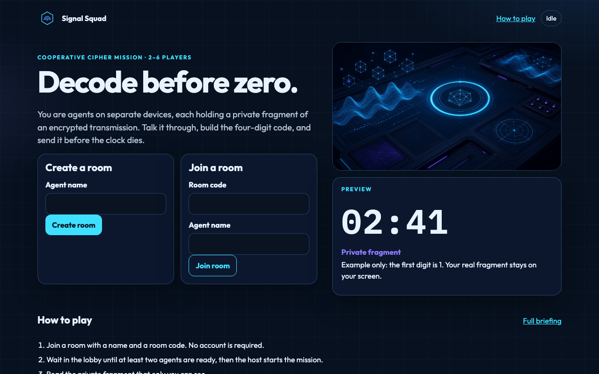
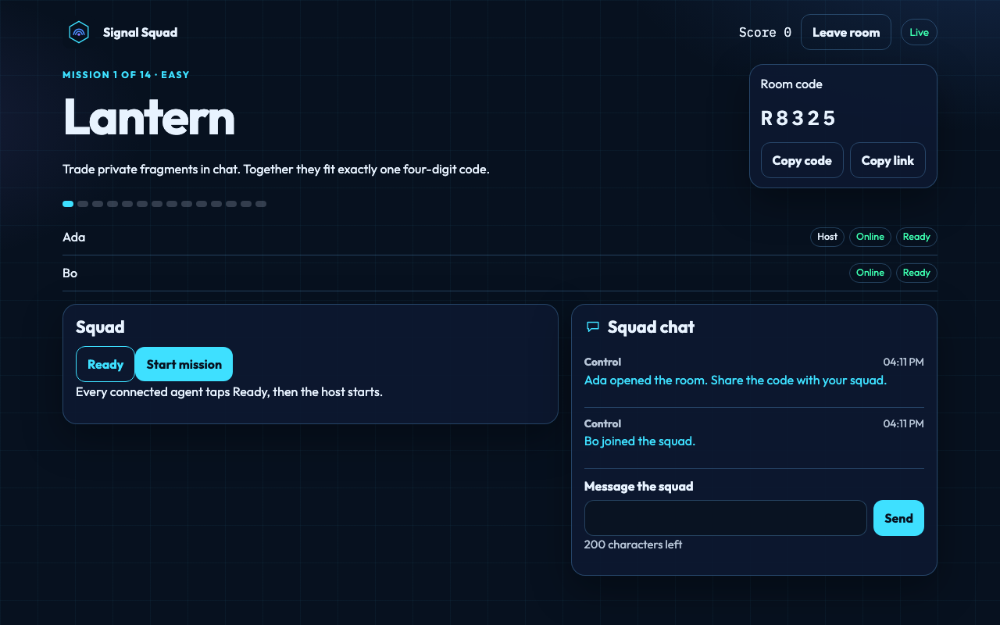
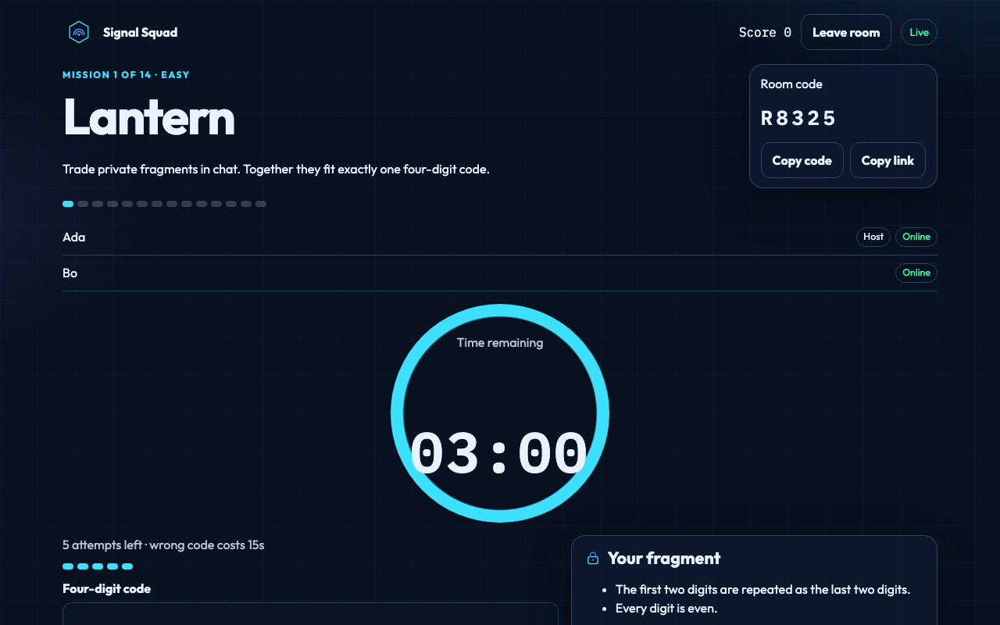
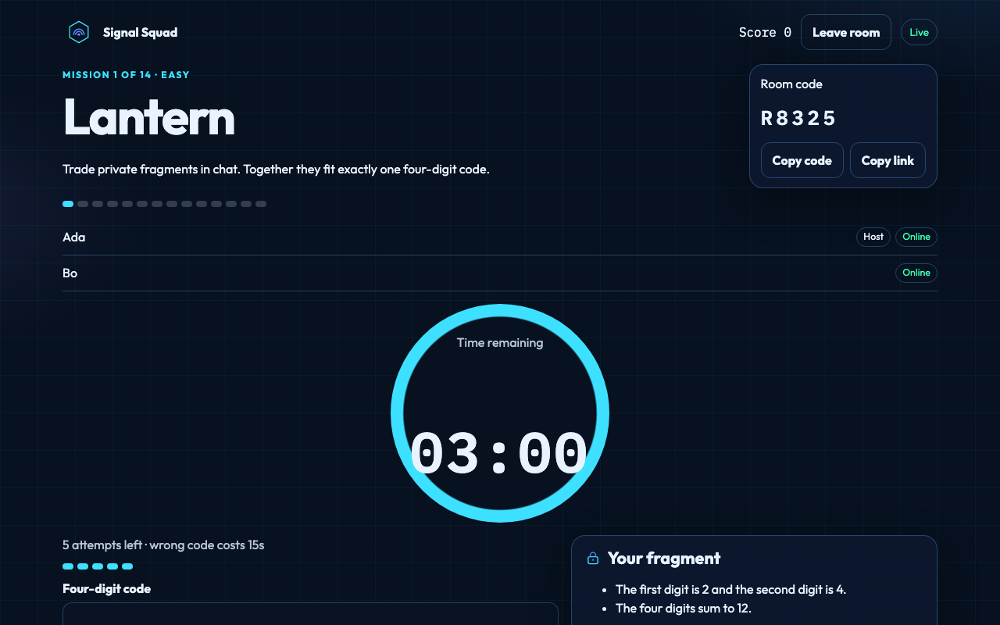
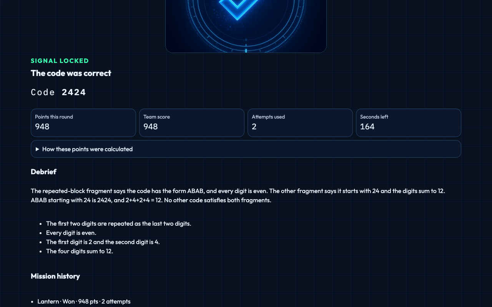
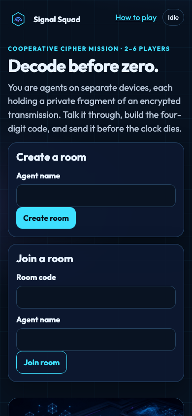

# Signal Squad: Decode Before Zero

A browser game for two to six people on separate phones, tablets, or computers. Each player holds a private fragment of an encrypted transmission. The squad talks it through, builds one four-digit code, and transmits it before the shared clock hits zero.

No account, install, or app store is required. One player creates a room and shares a five-character code. Everyone else opens the same site and joins.

## Game concept and audience

Signal Squad is a short cooperative puzzle for friends, classrooms, and live demos. Players are agents at a mission-control desk. The fun is the conversation: nobody can solve the mission from their own screen, and the server will not reveal another player's fragment.

The first three missions are easy and playable immediately. Later missions get harder. A full campaign is fourteen missions.

## Main features

- Real-time rooms for 2–6 players, joined with a room code or a share link.
- Authoritative game server. Countdown, clues, answers, attempts, and score are decided on the server.
- Private clue fragments. Each browser receives only that player's fragment until the round ends.
- Squad chat with length limits and rate limits.
- Shared countdown, five attempts, and a time penalty for a wrong code.
- Team score and a mission history. Points are awarded once per solved mission.
- Reconnect after a refresh, host transfer, and a safe leave.
- How to play, with a worked example that is not one of the campaign answers.
- Responsive layout for desktop, tablet, and phone.

## Visual preview

Screenshots captured from the running game:













## Gameplay and scoring

1. Join a room with a name and a room code. No account is required.
2. Wait in the lobby until at least two agents are ready, then the host starts the mission.
3. Read the private fragment that only you can see.
4. Tell the other agents what your fragment says, using the squad chat.
5. Combine every fragment. Together they describe exactly one four-digit code.
6. Transmit that code before the clock hits zero and before the squad runs out of attempts.
7. You win the round by solving the code. The round is lost when time expires or the attempts run out.

The worked example on the How to play page uses code **1234**. That code is not a campaign answer.

A wrong code uses one attempt and removes 15 seconds from the clock. The fifth wrong code ends the round. A correct code after the deadline does not score.

| Difficulty | Base | Each second left | Each unused attempt | Clock |
| --- | ---: | ---: | ---: | ---: |
| Easy | 500 | 2 | 40 | 3:00 |
| Medium | 800 | 3 | 60 | 4:00 |
| Hard | 1200 | 4 | 80 | 5:00 |

A lost round scores 0. The winning transmission counts as a used attempt. Replaying a mission that already scored does not add points again. The full rules are in [docs/GAME_RULES.md](docs/GAME_RULES.md).

## Technology stack

- Client: React 19, TypeScript, Vite 6, React Router.
- Server: Node.js 20+, Express 4, Socket.IO 4.
- Tests: Vitest, Playwright (Chromium).
- Production: one Node process serves the built client and the real-time API.
- Rooms live in memory. There is no database and no third-party realtime vendor.

## System architecture

The browser never owns the match. Socket.IO events create rooms, join them, start missions, chat, and submit codes. The server stores the phase (`WAITING`, `READY`, `IN_PROGRESS`, `WON`, `LOST`, `COMPLETED`), the deadline, the attempts, and the score. Each socket receives its own snapshot: a public view for everyone, plus that player's private fragment.

Clue text and the answer stay on the server until the round ends. The client bundle does not import the puzzle file.

Details, state transitions, and the host-transfer policy are in [docs/ARCHITECTURE.md](docs/ARCHITECTURE.md).

## Repository layout

The playable project is this `game/` directory.

```
game/
  client/           React application
  server/           Express, Socket.IO, room engine, puzzles
  shared/           Types, validation, scoring, public rules
  public/assets/    Logo, mission art, icons
  tests/unit/       Puzzle, scoring, room, and policy tests
  tests/integration/ Two-socket realtime tests
  tests/e2e/        Two-browser Playwright journey
  docs/             Rules, architecture, testing, deployment, assets
  dist/             Production build (generated)
```

The parent folder also contains unrelated PDFs. They are not part of the game.

## Prerequisites

- Node.js 20 or newer (developed on Node 22)
- npm 10
- Chromium for Playwright, installed with `npx playwright install chromium` when you want the browser tests

No database, API key, or external account is required to run locally.

## Installation

From this directory:

```bash
npm install
npx playwright install chromium
```

## Local development

```bash
npm run dev
```

This starts the API on port 8787 and the Vite client on http://127.0.0.1:5173. Vite proxies `/api` and `/socket.io` to the API, so the browser uses one origin.

Open http://127.0.0.1:5173. Create a room in one browser, then join from a second browser or a private window with the room code.

## Environment variables

Copy the example file if you want to change defaults. The example contains no secrets, because the game does not use any.

```bash
cp .env.example .env
```

| Variable | Default | Purpose |
| --- | --- | --- |
| `PORT` | `8787` | HTTP and WebSocket port |
| `HOST` | `0.0.0.0` | Bind address |
| `NODE_ENV` | unset in dev | `production` serves the built client |
| `TRUST_PROXY` | `0` | Set to `1` behind a proxy that sends `X-Forwarded-For` |
| `ROOM_TTL_MS` | `10800000` | Room lifetime from creation (3 hours) |
| `HOST_GRACE_MS` | `45000` | How long a disconnected host keeps the role during a mission |
| `DISCONNECT_REMOVE_MS` | `600000` | How long a disconnected player can reconnect (10 minutes) |
| `EMPTY_ROOM_MS` | `900000` | How long an empty room is kept (15 minutes) |
| `ROUND_MS_EASY` | `180000` | Easy round length |
| `ROUND_MS_MEDIUM` | `240000` | Medium round length |
| `ROUND_MS_HARD` | `300000` | Hard round length |
| `PENALTY_MS` | `15000` | Clock removed after a wrong code |

Invalid values fail at startup. An empty value keeps the default. Tests pass configuration in code and do not read these variables.

## Backend and realtime setup

Nothing extra to provision. `npm run dev` and `npm start` both run the Socket.IO server inside the same Node process as Express. The client connects to the page origin. In development, Vite forwards the WebSocket. In production, Express serves the client and Socket.IO on the same port.

## Database setup

None. Rooms, chat, and scores are stored in process memory. Restarting the server clears every room. See [Known limitations](#known-limitations).

## How to run the application

Development:

```bash
npm run dev
```

Production, after a build:

```bash
npm run build
npm start
```

`npm start` sets `NODE_ENV=production` and serves `dist/client` plus the API on port 8787. Open http://127.0.0.1:8787.

Health check: `GET /api/health` returns `{ "ok": true, "service": "signal-squad", "rooms": <number> }`.

## How to run each test suite

```bash
npm run typecheck
npm run lint
npm test                  # unit and integration
npm run test:unit
npm run test:integration
npm run test:e2e          # two Chromium contexts; starts the dev server
npm run test:all
npm run build
```

`npm run test:e2e` expects Playwright Chromium. It starts `npm run dev` unless a server is already on port 5173.

Latest local run, after the implementation and the QA fixes:

| Suite | Result |
| --- | --- |
| Typecheck | Passed (server and client) |
| Lint | Passed |
| Unit + integration (`npm test`) | 2 files, 20 tests passed, 0 failed, 0 skipped |
| End-to-end (`npm run test:e2e`) | 3 tests passed, 0 failed, 0 skipped |
| Production build | Passed |

Re-run the commands above on a fresh checkout. Do not treat this table as a substitute for executing the suites.

## How to test multiplayer with two clients

1. Run `npm run dev`.
2. In browser A, enter a name and choose **Create room**.
3. Copy the room code, or copy the link (`/room/CODE`).
4. In browser B, a private window, or another device on the same network, open the site and join with that code and a different name.
5. Both players choose **I understand**, then **Ready up**.
6. The host chooses **Start mission**.
7. Confirm the fragments differ. Say them in chat. Transmit the code.
8. Both screens should show the same result and the same team score.
9. The host can start the next mission. Refresh one tab; the same mission and fragment should return.
10. One player can leave. The other should see that name drop off the squad list.

A written checklist is in [docs/TESTING.md](docs/TESTING.md).

For a second device on your LAN, use the computer's LAN address with the Vite host. The dev script binds Vite to `127.0.0.1` only. To reach it from a phone, stop the dev server and run:

```bash
npx vite --host 0.0.0.0
```

in a second terminal while `tsx watch server/index.ts` is still running, or temporarily change the host. The phone must be able to reach both the page and the proxied API, which it can when it loads the Vite URL.

## Deployment

One process is the whole deployment: `npm run build`, then `npm start`. Set `PORT` to the port your host assigns, and set `TRUST_PROXY=1` when the host terminates TLS and forwards the real client IP.

Prepared files:

- `Dockerfile` — multi-stage Node 22 image. `CMD` is `node dist/server/index.js` with `NODE_ENV=production`.
- `render.yaml` — Render web service, health check `/api/health`.
- `fly.toml` — Fly.io service on port 8787. The app name `signal-squad-decode` is a suggestion; change it if it is taken.
- `Procfile` — `web: npm start` for hosts that read a Procfile.

Step-by-step host commands are in [docs/DEPLOYMENT.md](docs/DEPLOYMENT.md).

This workspace does not have a hosting login, a Fly or Render token, or a tunnel client. No public URL was created. Do not treat a local `http://127.0.0.1` address as the public game URL.

## Production environment variables

Set at least:

```bash
NODE_ENV=production
TRUST_PROXY=1
PORT=8787
```

`npm start` already sets `NODE_ENV=production` on Unix. A Docker or platform start command should set it in the environment, which the Dockerfile and `render.yaml` do. Do not put credentials in the frontend. This game has none.

## Known limitations

- Rooms are in memory on one process. A restart, a new deploy, or a second instance drops or splits rooms. This is suitable for a live demo on a single instance, and it is not durable storage.
- The process cannot be scaled horizontally. Sticky sessions would not be enough, because another instance has a different room map.
- There are no accounts. A player token in `sessionStorage` is only for reconnecting to a room. It is not a login.
- Chat history is lost when the room expires or the process restarts.
- A room expires three hours after it was created. A disconnected player is removed after ten minutes.
- During a mission, a disconnected host keeps the role for 45 seconds. In the lobby, the host role moves immediately.
- A player who joins after a mission has started can chat and submit, and receives a private fragment only when a departed player left one behind.
- Rate limits and a content security policy reduce abuse. They are not a security certification.
- `npm start` sets `NODE_ENV` with Unix shell syntax.

## Security considerations

- Room membership uses a random 32-byte token. The server stores a SHA-256 hash and compares it with `timingSafeEqual`.
- Room codes are five characters from an alphabet that omits easily confused letters. They are not sequential.
- Private fragments are sent only on that player's socket. The public snapshot has no clue text and no answer until the round is over.
- The puzzle module is imported by the server only. The client build does not include answers.
- Chat is rendered as text. Messages are length-limited, stripped of control characters, and rate-limited.
- Answer submissions are rate-limited. Simultaneous correct submissions award the score once.
- Create and failed-join attempts are limited per IP. `TRUST_PROXY` is off unless you set it, so a client cannot spoof the address by default.
- Production responses set `nosniff`, `no-referrer`, `DENY` framing, a permissions policy, and a content security policy locked to the same origin.
- Logs record event names. They do not record tokens, clue text, or chat text.
- `.env.example` has no secrets. Do not commit a real `.env`.

## Troubleshooting

- **Port 8787 is in use.** Set `PORT` to a free port. Vite's proxy target is `127.0.0.1:8787`; if you change the API port, update `vite.config.ts` to match.
- **The second browser says there is no active room.** Both browsers must talk to the same server process. Two `npm run dev` processes do not share rooms.
- **Refresh sent me home.** The reconnect window is ten minutes, the room may have expired, or the server restarted and forgot the room.
- **I cannot see the other player's fragment.** That is intentional until the round ends. Use chat.
- **Start mission stays disabled.** You need two connected players, and every connected player must be ready. Only the host can start. Later missions do not ask for ready again.
- **A phone on the same Wi-Fi cannot open localhost.** Localhost is the phone itself. Use the computer's LAN address, and bind Vite to `0.0.0.0` as described above.
- **Playwright cannot find a browser.** Run `npx playwright install chromium`.

## Credits and asset licenses

- Original SVG logo, signal icons, and the mission-control fallback were drawn for this project.
- The photographic-style illustrations (`logo-mark.jpg`, `mission-control.jpg`, `success.jpg`, `failure.jpg`) were generated for this project. They contain no third-party characters or trademarks.
- Outfit and IBM Plex Mono are loaded through Fontsource and remain under the SIL Open Font License.
- Application code in this directory was written for Signal Squad.

See [docs/ASSETS.md](docs/ASSETS.md).

## Future improvements

- A durable room store so a restart can restore an active match.
- A public hosted URL on a single always-on instance.
- Optional voice, or a clearer "read this aloud" prompt on each fragment.
- Host controls to pick a difficulty instead of only walking the campaign in order.
- Richer observer tools for a classroom display that shows no private fragments.
